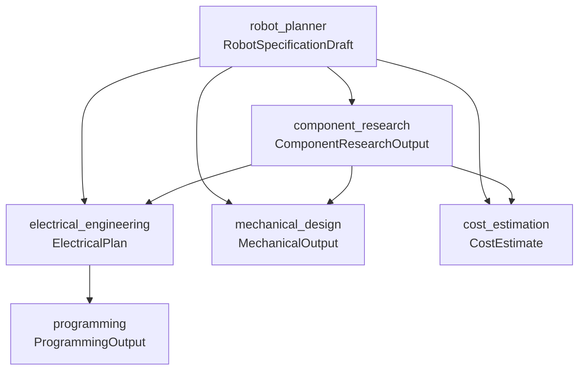

# AI agents

Blueprints Baker decomposes robot design into six specialized agents. Each agent owns one artifact and
works against a typed contract. The orchestrator is deterministic: it resolves dependencies, runs
agents in a fixed order, validates outputs before accepting them, and records every execution.

**Current state:** three agents are implemented and deterministic — `robot_planner`,
`component_research`, and `electrical_engineering` — and the wiring system exports
CSV/SVG/Markdown/JSON plus a KiCad netlist. They do not call a model: the curated component
library and rules engine produce the same result for the same input, which makes every finding
reproducible and testable offline. `programming`, `mechanical_design`, and `cost_estimation`
remain placeholders returning `status: "not_implemented"` (or `skipped` if a dependency failed).
The orchestration, contracts, API, and persistence are fully implemented and tested, so each
remaining agent can be filled in without changing the pipeline.

## Why this shape

A single all-knowing prompt would be easier to demo and worse to operate. Robotics decisions are
coupled: a motor choice changes the driver, the power budget, the chassis, the firmware, and the
price. Typed artifacts give us:

- **Inspectability** — every step is a persisted, reviewable document.
- **Partial progress** — a user can approve the specification before parts are selected.
- **Safe failure** — a failed agent blocks only its dependents, not the whole project.
- **Provider independence** — model choice is an infrastructure concern.
- **Testability** — contracts and orchestration are verified without network access.

## Pipeline



| Agent | Depends on | Owns shared slot | Milestone | Owner area |
| --- | --- | --- | --- | --- |
| `robot_planner` | — | `specification` | M3 | AI Engineering |
| `component_research` | planner | `component_research` | M4 | AI Engineering / Integrations |
| `electrical_engineering` | planner, components | `electrical` | M5 | Robotics / Electrical |
| `programming` | planner, components, electrical | `programming` | M6 | AI Engineering / Firmware |
| `mechanical_design` | planner, components | `mechanical` | M7 | Mechanical Design |
| `cost_estimation` | planner, components | `cost` | M8 | AI Engineering / Integrations |

In this release the first three rows run deterministically (no model). The milestone column
records the roadmap milestone that originally scoped each capability; M3–M5 still own the
model-backed and supplier-integrated versions.

Pipeline order is fixed (`PIPELINE_ORDER`), even when a request selects a subset. Requested agents
are expanded with transitive dependencies. For example, requesting `programming` runs the planner,
component research, electrical, and programming agents.

## Contracts

Contracts live in [`apps/api/app/ai/contracts.py`](../apps/api/app/ai/contracts.py) and are exported
to [`packages/contracts/schemas/`](../packages/contracts/schemas/) as JSON Schema. All contract models
reject unknown fields (`extra="forbid"`) to surface drift immediately.

### Envelopes

| Model | Purpose |
| --- | --- |
| `ProjectContext` | Project identity, robot type, description, budget, and the shared context |
| `AgentRequest` | `context` + per-run `parameters` (validated against the agent input model) |
| `AgentResult` | `agent`, `status`, `summary`, `output`, warnings, sources, usage, timestamps |
| `SharedProjectContext` | Accumulated artifacts: specification, components, electrical, programming, mechanical, cost, notes |
| `OrchestrationResult` | Overall status, per-agent results, and the final shared context |

### Artifacts

| Artifact | Highlights |
| --- | --- |
| `RobotSpecificationDraft` | Summary, use case, robot type, difficulty, platform, drive type, environment, dimensions, requirements, constraints, success criteria, open questions, confidence |
| `ComponentResearchOutput` | Role-based bill of materials, candidates with specs/price/supplier, alternatives, compatibility notes, unresolved requirements |
| `ElectricalPlan` | Nodes, typed connections, full pinout, power budget, safety checks, warnings, wiring steps |
| `ProgrammingOutput` | Platform, language/framework, code files, libraries, pin assignments, setup/upload/validation steps |
| `MechanicalOutput` | Chassis, parts, ordered assembly steps, drawing references, manufacturing notes, warnings |
| `CostEstimate` | Line items, subtotal/shipping/contingency/total, budget status, alternatives, assumptions |

### Per-agent inputs

`PlannerInput`, `ComponentResearchInput`, `ElectricalInput`, `ProgrammingInput`,
`MechanicalInput`, and `CostInput` define what each agent is allowed to rely on. In particular,
the programming agent receives the electrical plan; it must not invent pins.

## Orchestration semantics

Source: [`apps/api/app/ai/orchestrator.py`](../apps/api/app/ai/orchestrator.py).

1. **Resolve** the requested agent set (or the whole pipeline) plus transitive dependencies.
2. **Validate** the registry: every pipeline agent exists and declares known dependencies.
3. For each agent in pipeline order:
   - If any dependency did not succeed, mark the agent `skipped` with a blocking reason.
   - Otherwise build an `AgentRequest` with the accumulated shared context.
   - Run the agent, append its `AgentResult`, and record its status.
   - On success, validate `output` into the agent's slot by re-validating
     `SharedProjectContext`. Invalid output flips the result to `failed`; it is never partially
     applied.
4. Compute the overall status from individual results:
   - all succeeded → `succeeded`
   - any failed → `failed`
   - any not implemented → `not_implemented`
   - all skipped → `skipped`
   - otherwise → `failed`

A failure does not abort independent branches. For example, a failed electrical agent skips
programming but mechanical and cost can still run if their dependencies succeeded.

### Why sequential

Model calls are the expensive, slow, least deterministic part of the system. Sequential execution
makes cost predictable, keeps the audit trail linear, and avoids concurrent writes to shared
context. Parallel branches are a later optimization once artifacts and latency are measured.

## Provider boundary

Source: [`apps/api/app/ai/provider.py`](../apps/api/app/ai/provider.py).

```python
class LLMProvider(ABC):
    name: str

    @property
    @abstractmethod
    def default_model(self) -> str: ...

    @abstractmethod
    async def generate(self, request: LLMRequest) -> LLMResponse: ...

    async def health(self) -> bool: ...
```

- `LLMRequest` carries messages, model, temperature, token limit, an optional response schema, and
  metadata.
- `LLMResponse` carries content, provider, model, usage, and optional raw payload.
- `MockProvider` is the only registered provider. It is deterministic and offline, and explicitly
  labels its output as a placeholder. It exists to exercise infrastructure, not to pretend to think.
- `AI_PROVIDER` selects a provider; unknown providers fail fast with a configuration error.
- Real providers are added in M3 by registering a factory in `PROVIDER_FACTORIES`. Vendor SDK
  imports stay inside that module.

Every model-backed agent must validate the response against its Pydantic output contract before
returning. Retries belong in the provider adapter; contract failures belong to the agent.

## HTTP surface

- `GET /api/v1/agents` returns provider, default model, and descriptors (dependencies, schemas,
  milestone, owner area, availability).
- `POST /api/v1/projects/{id}/agent-runs` runs a selection and returns the orchestration result plus
  persisted runs.
- `GET /api/v1/projects/{id}/agent-runs` returns the audit history.

The service layer converts the project aggregate into `ProjectContext`, runs the orchestrator, and
persists one `AgentRun` per result. Parameters are stored in `input_payload`; outputs are stored only
when they passed validation.

## Implementing a placeholder agent

Deterministic agents subclass `BaseAgent` and set `status = "available"`; placeholder agents
keep `status = "placeholder"`. The planner and component research live in
`app/ai/agents/planner.py` and `component_research.py`; the electrical agent delegates to
`app/electrical/engine.py` so validation stays independent of the HTTP and agent layers.

1. **Read the agent module** in `apps/api/app/ai/agents/`. Its docstring lists responsibilities and
   the contract it owns.
2. **Refine the contract** if necessary. Add fields deliberately; unknown fields are rejected.
   Regenerate contracts with `make contracts`.
3. **Inject the provider** through the constructor (the orchestrator currently instantiates agents
   without arguments; update `build_agent_registry` when enabling a real agent).
4. **Build the prompt** from `AgentRequest.context` and parameters. Never rely on conversation
   history or hidden global state.
5. **Validate output** into the declared `output_model`. On failure, return
   `AgentResult(status="failed", error=...)`, not a partial artifact.
6. **Record usage** (tokens, latency) in the result so the audit trail can report cost.
7. **Test** with fixed inputs and a fake provider: success, invalid JSON, schema violation, timeout,
   and dependency-blocked paths.
8. **Update docs and the catalog** if dependencies, milestone, or status change.

Do not make an agent write another agent's slot. Do not call HTTP or the database from an agent.

## Safety and trust boundaries

- **Generated code is untrusted.** M6 must treat firmware as text to display and validate, never as
  something the server executes.
- **Electrical advice is safety-critical.** Deterministic rules must back model output: voltage
  compatibility, driver requirements, shared ground, current margin. A model must not be the only
  thing standing between a user and a shorted battery.
- **Prompt injection** from project descriptions or supplier pages is expected. Agents must treat
  retrieved text as data, not instructions, and only emit artifacts in the declared schema.
- **No secrets in prompts or logs.** Provider keys stay server-side; logs contain request IDs and
  metadata, not full API keys.
- **Cost controls** (M3+): per-run token ceilings, per-user quotas, timeouts, and recorded usage.

## Evaluation strategy

Before an agent is considered available:

- A fixture set of realistic robot briefs covering each robot type and difficulty.
- Contract validity rate (target 100% after repair/retry).
- Requirement coverage and hallucination checks (e.g. no invented pin numbers or libraries).
- Human review rubric for usefulness, safety, and clarity.
- Regression snapshots for prompts and deterministic validation rules.

## Milestones

| Milestone | AI work |
| --- | --- |
| M3 | Provider registry, real planner agent, structured output repair/retry, evaluation harness |
| M4 | Component research output, catalog retrieval, supplier adapter boundary |
| M5 | Electrical plan + deterministic safety validation |
| M6 | Firmware generation, static checks, code artifact storage |
| M7 | Mechanical plan and assembly instructions |
| M8 | Cost roll-up, assumptions, budget alternatives |
| M9 | Export assembled artifacts as a build bundle |
| M10 | Cost controls, observability, prompt/model versioning, evaluation in CI |
