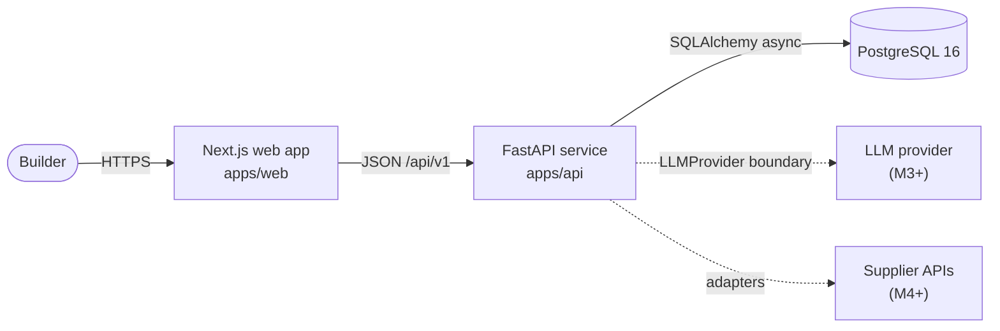
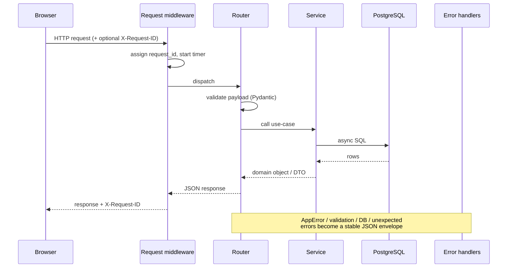
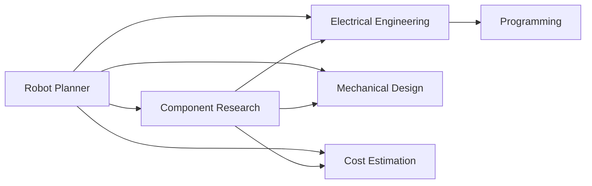
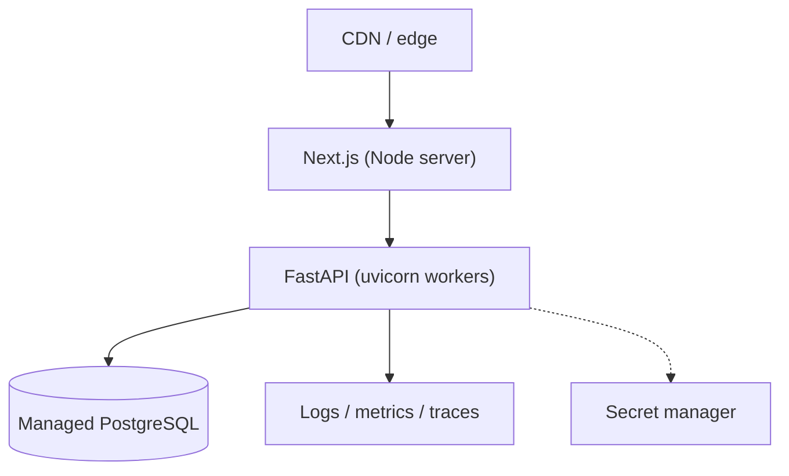

# Architecture

Blueprints Baker is a modular monolith: one deployable API and one web application in a single repository,
with explicit internal boundaries. The foundation optimizes for a small team that needs to move
quickly without turning coupled engineering artifacts into a distributed-system problem.

## System context



The browser never talks to the database or a model provider directly. The web app is a client of the
versioned API, which owns validation, orchestration, persistence, and auditability.

## Repository boundaries

| Path | Responsibility | May depend on |
| --- | --- | --- |
| `apps/api/app/api` | HTTP routing, dependencies, status codes | services, schemas, core |
| `apps/api/app/services` | Use-cases and transaction boundaries | models, schemas, `app.ai` |
| `apps/api/app/models` | SQLAlchemy persistence model, enums, constraints | core |
| `apps/api/app/ai` | Provider boundary, contracts, agents, orchestrator | models/enums only |
| `apps/api/app/schemas` | HTTP request/response contracts | models/enums, `app.ai.contracts` |
| `apps/api/app/core` | Settings, DB engine, logging, errors | — |
| `apps/web/src/app` | Routes, layouts, server components | components, lib |
| `apps/web/src/components` | UI primitives and feature views | lib, hooks |
| `apps/web/src/lib` | API client, types, constants, formatting | — |
| `packages/contracts` | Generated OpenAPI + JSON Schemas | backend build output |

The API layer does not contain SQL. Services do not construct HTTP responses. Agents do not import
FastAPI, SQLAlchemy sessions, or a vendor SDK. This keeps each layer independently testable.

## Backend request flow



Cross-cutting behavior:

- **Request IDs** are accepted from `X-Request-ID` or generated, echoed in the response, and attached
  to every log line for that request.
- **Errors** use one envelope: `{"error": {"code", "message", "details", "request_id"}}`.
  Validation failures return 422 with field locations; missing resources return 404; database
  outages return 503 without leaking internals.
- **Logging** is human-readable in development and JSON in staging/production.
- **CORS** is allow-listed from `CORS_ORIGINS`; credentials are disabled in production once auth
  lands (M2).
- **Docs** are exposed at `/docs`, `/redoc`, and `/openapi.json` outside production only.

## The AI pipeline

The agent layer is a deterministic graph, not an autonomous swarm. The planner produces a
specification; downstream agents each add one artifact to a shared context.



Execution is sequential in a fixed pipeline order. The orchestrator resolves transitive
dependencies, skips agents whose dependencies did not succeed, validates every output against its
contract before applying it, and records a run per agent. See [ai-agents.md](ai-agents.md).

This design deliberately avoids:

- **Parallel agent fan-out** until each agent's inputs are stable and model costs are understood.
- **Free-form agent chat** as a source of truth; artifacts are typed and persisted.
- **Vendor lock-in**: all model calls pass through `LLMProvider`.

## Frontend architecture

```text
src/app/
├── page.tsx                         Marketing landing (server component)
├── (workspace)/
│   ├── layout.tsx                   App shell: sidebar, topbar, mobile nav
│   ├── dashboard/page.tsx           Project list and empty state
│   └── projects/
│       ├── new/page.tsx            Create-project form
│       ├── [id]/page.tsx           Project overview + agent roster
│       └── [id]/[module]/page.tsx  Module workspace or milestone scaffold
├── layout.tsx                       Fonts, metadata, global styles
└── globals.css                      Tailwind theme tokens and base styles
```

- The workspace shell is client-side where it needs interactivity (navigation, mobile drawer, data
  fetching); server components handle static marketing and route shells.
- `src/lib/api.ts` is the only place that calls the API. It normalizes failures into `ApiError`.
- `use-projects.ts` owns list/create/delete state; feature components stay presentational.
- Module routes are generated from `PROJECT_MODULES`, which also carries the owning milestone. A
  module route that exists but is not yet available renders a deliberate scaffold instead of a broken
  page.
- Generated OpenAPI types (`api-schema.ts`) are available for low-level clients; the workspace uses
  explicit hand-written types so the UI can model absent/optional fields honestly.

## Data architecture

PostgreSQL is the system of record. The schema separates the project aggregate from the reusable
component catalog, and snapshots commercial data (unit price) on selection. Agent runs are an
append-only audit trail, not a cache of current state.

Key choices:

- UUID primary keys for stable references across agents and URLs.
- Timezone-aware timestamps, server defaults, and `updated_at` maintained by SQLAlchemy.
- String-backed enums via `native_enum=False` for portable migrations and readable rows.
- `JSON` columns for evolving dimensions/specs; relational columns for anything queried or
  constrained.
- Cascading deletes from a project to its specification, configuration, selections, and runs;
  `components` are protected by `RESTRICT` on selection rows.
- Explicit naming conventions so Alembic diffs are deterministic.

See [database.md](database.md) for the ERD and table reference.

## Deployment topology

The target production topology is intentionally boring:



- The web app builds with Next.js output for a Node server (`next start`), or a static export in
  demo mode.
- The API is stateless; sessions and audit records live in PostgreSQL.
- Migrations run once per deploy from the container entrypoint (`alembic upgrade head`), or as a
  separate deploy step on platforms that support pre-deploy commands. Never run them per request.
- Health (`/health`) is a liveness probe; readiness (`/health/ready`) verifies the database.
- Horizontal scaling of the API is safe because agent execution is request-scoped and persisted
  synchronously. Long-running jobs will move to a queue in a later milestone if latency demands it.

The included `docker-compose.yml` only provides PostgreSQL for local development. It is not a
production deployment definition.

A separate GitHub Pages build publishes a read-only demo. It is the same web app built with
`NEXT_PUBLIC_DEMO_MODE=true` from precomputed fixtures produced by the deterministic engine, so the
public artifact contains no API, database, or secrets. It is a showcase, not a deployment
topology for the product; see [demo-site.md](demo-site.md).

## Security posture

Current foundation:

- No authentication. Projects are global and `owner_id` is nullable. This is a known, documented
  gap, not an accident.
- Secrets come from environment variables; `.env` files are git-ignored and `.env.example` contains
  placeholders only. Browser-visible values are limited to `NEXT_PUBLIC_*`; provider keys never
  cross that boundary, and the Pages build is scanned for credential-shaped strings before deploy.
- CORS is allow-listed.
- Input lengths, numeric ranges, budget ordering, and contract shape are validated.
- Production hides interactive API docs.
- Database errors are logged with a request ID and returned as generic 503s.

Planned before public launch (M2, M10): authentication and ownership checks, per-user rate limits,
CSRF/session hardening, dependency and container scanning, restricted CORS, encrypted backups, and a
security review of any supplier/model integration.

## Tradeoffs and alternatives

| Decision | Benefit | Cost / when to revisit |
| --- | --- | --- |
| Modular monolith | Simple transactions, one deploy, fast iteration | Split only when a component has independent scaling or team ownership needs |
| Sequential orchestration | Predictable cost, debuggable, easy to audit | Add parallel branches/queues when model latency dominates |
| PostgreSQL + JSON | Relational integrity with evolving engineering payloads | Normalize JSON fields once query patterns stabilize |
| Typed contracts with `extra="forbid"` | Catches model/provider drift immediately | Contract changes require coordinated regeneration |
| Placeholder agents | Verifies the graph without API keys or cost | Implement in milestone order; do not fake success |
| No auth in foundation | Focus on the domain skeleton | Must land before any multi-user deployment |

Architecture decisions are recorded in [decisions/](decisions/).
