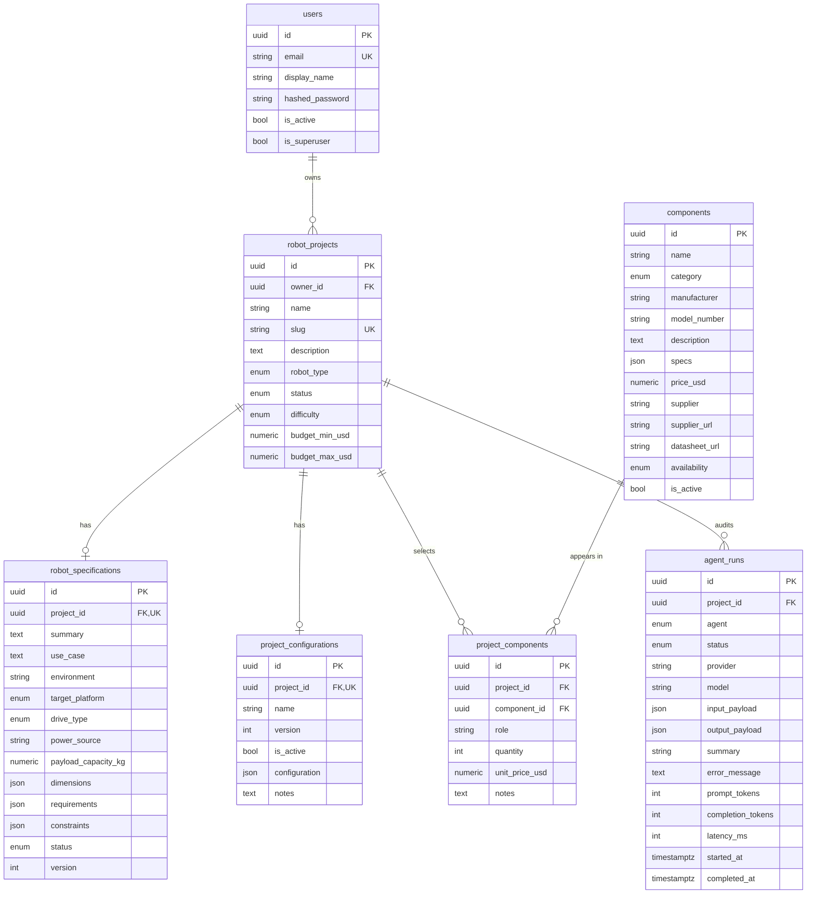

# Database

RoboCraft uses PostgreSQL 16 as its runtime database, SQLAlchemy 2.0's async ORM, and Alembic for
schema migrations. SQLite (`aiosqlite`) is supported **only** for the automated test suite; it is not
a deployment target.

## Entity–relationship diagram



All tables carry `created_at`/`updated_at` timestamptz columns (omitted above for readability).

## Tables

### `users`

Account record. Authentication is scheduled for M2; the table exists so projects can be scoped
without a destructive migration later.

| Column | Type | Rules |
| --- | --- | --- |
| `id` | uuid | PK, generated in Python |
| `email` | varchar(320) | unique, indexed, not null |
| `display_name` | varchar(120) | not null |
| `hashed_password` | varchar(255) | nullable (OAuth-only users) |
| `is_active`, `is_superuser` | boolean | default `true` / `false` |
| `created_at`, `updated_at` | timestamptz | server default `now()` |

### `robot_projects`

The aggregate root. Deleting a project cascades to its specification, configuration, selections, and
agent runs.

| Column | Type | Rules |
| --- | --- | --- |
| `id` | uuid | PK |
| `owner_id` | uuid | FK `users.id` `ON DELETE CASCADE`, nullable until M2 |
| `name` | varchar(120) | not null |
| `slug` | varchar(140) | unique, indexed; derived from name |
| `description` | text | not null, default `''` |
| `robot_type` | enum(`robot_type`) | default `custom` |
| `status` | enum(`project_status`) | default `draft` |
| `difficulty` | enum(`difficulty`) | default `beginner` |
| `budget_min_usd`, `budget_max_usd` | numeric(10,2) | nullable; max ≥ min when both set |
| `created_at`, `updated_at` | timestamptz | server default `now()` |

Indexes: `(status, created_at)`, `owner_id`, unique `slug`.

### `robot_specifications`

One-to-one with a project (`project_id` is unique). Created automatically with a project from the
request description; edited manually via `PUT` or replaced by the planner in M3.

`dimensions`, `requirements`, and `constraints` are JSON because their shape is still evolving.
`version` increments on every successful specification update. Status is `draft`, `generated`, or
`approved`.

### `project_configurations`

Reserved for resolved hardware/software configurations (one active configuration per project in the
current model). `configuration` is JSON so a configuration can be snapshotted without changing the
schema for every new artifact type. Not exposed by the API yet.

### `components`

The reusable component catalog, populated in M4. `specs` is JSON for datasheet-style attributes.
Commercial fields (`price_usd`, `supplier`, `supplier_url`, `availability`) describe the current
catalog record; project selections snapshot `unit_price_usd` so historical estimates do not silently
change.

Indexes: `name`, `(category, is_active)`. Unique constraint on `(project_id, component_id, role)`
and check `quantity > 0` live on `project_components`.

### `project_components`

Join table between projects and catalog components, with selection-specific data.

| Column | Type | Rules |
| --- | --- | --- |
| `project_id` | uuid | FK project, cascade delete, indexed |
| `component_id` | uuid | FK component, `ON DELETE RESTRICT` |
| `role` | varchar(80) | e.g. `left drive motor` |
| `quantity` | integer | > 0 |
| `unit_price_usd` | numeric(10,2) | nullable snapshot |
| `notes` | text | not null, default `''` |

### `agent_runs`

Append-only audit record for each agent execution. One row is written per agent in an orchestration
request, including skipped agents.

| Column | Type | Notes |
| --- | --- | --- |
| `agent` | enum(`agent_name`) | one of the six agents |
| `status` | enum(`agent_run_status`) | `queued`, `running`, `succeeded`, `failed`, `cancelled`, `skipped`, `not_implemented` |
| `provider`, `model` | varchar | provider/model used for traceability |
| `input_payload` | json | request parameters (not the entire shared context) |
| `output_payload` | json | nullable validated artifact |
| `summary`, `error_message` | text | human-readable outcome |
| `prompt_tokens`, `completion_tokens`, `latency_ms` | integer | usage/cost accounting |
| `started_at`, `completed_at` | timestamptz | set by the agent result |

Indexes: `(project_id, created_at)` for history queries and `(agent, status)` for operations.

## Conventions

- **UUID keys** are generated in Python (`uuid.uuid4`) so records can be referenced before commit.
- **Enums** use `native_enum=False` (string-backed varchar(32) with a check constraint). This keeps
  migrations simple and rows readable; validation also happens at the Pydantic/ORM boundary.
- **Money** uses `NUMERIC(10,2)` in PostgreSQL, mapped to `Decimal`.
- **Timestamps** are timezone-aware and defaulted by both Python and the server. `updated_at` is
  maintained by SQLAlchemy on update.
- **Naming** is deterministic via the metadata naming convention
  (`pk_`, `fk_`, `uq_`, `ck_`, `ix_`).
- **JSON** columns are used for flexible engineering payloads; anything filtered, joined, or
  constrained gets a real column. JSONB can replace JSON later if containment queries are needed.
- **Migrations** are hand-reviewed. `alembic check` must report no pending model changes.

## Migration workflow

```bash
cd apps/api

uv run alembic upgrade head       # apply
uv run alembic downgrade -1       # roll back one revision
uv run alembic current            # current revision
uv run alembic history            # revision graph
uv run alembic check              # models vs. migrations drift

# after changing a model
uv run alembic revision --autogenerate -m "add component supplier"
# review the generated file, then upgrade/downgrade/upgrade again
```

The initial revision is
[`apps/api/alembic/versions/a4d5e45cb5ea_initial_schema.py`](../apps/api/alembic/versions/a4d5e45cb5ea_initial_schema.py).
It was verified on PostgreSQL 16 with upgrade → downgrade → upgrade and `alembic check`.

Alembic reads `DATABASE_URL` from the same settings as the application, so both the API and
migrations use one source of truth. Migrations run as a separate deployment step — never on
application startup.

## Test database

Tests create a temporary SQLite file per test session, create the schema from SQLAlchemy metadata,
and never touch PostgreSQL. This keeps tests fast and hermetic, but it means SQLite-specific
behavior must not be relied on. PostgreSQL-specific behavior (migration DDL, constraints, numeric
semantics) is verified by the `migrations` CI job against a real PostgreSQL 16 service.

## Data lifecycle and privacy

- Deleting a project removes its derived artifacts and audit runs. Catalog components are protected
  while referenced.
- Agent runs can contain user descriptions and generated artifacts; treat them as user data and
  include them in export/deletion flows. No retention policy exists yet (M10).
- No real user data should be stored in the current public, unauthenticated foundation deployment.
